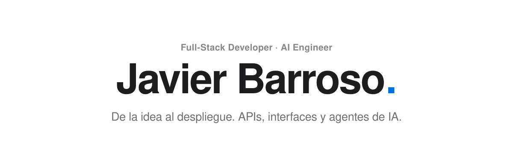
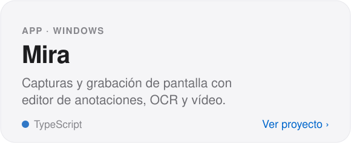
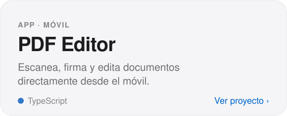
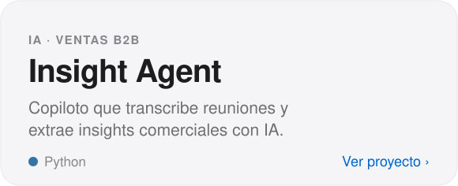
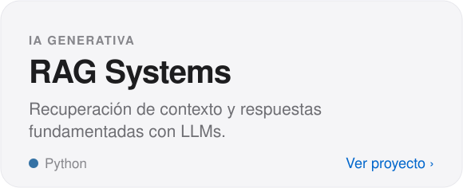
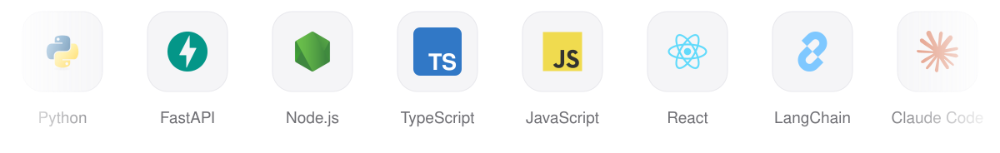

 

  <picture>
    <source media="(prefers-color-scheme: dark)" srcset="assets/header-dark.svg">
    
  </picture>

 

  <a href="https://github.com/GuaSiMoTO/APP-MIRA"><picture><source media="(prefers-color-scheme: dark)" srcset="assets/card-mira-dark.svg"></picture></a>&nbsp;<a href="https://github.com/GuaSiMoTO/APP-pdf-editor"><picture><source media="(prefers-color-scheme: dark)" srcset="assets/card-pdf-editor-dark.svg"></picture></a>

  <a href="https://github.com/GuaSiMoTO/Insight-Agent"><picture><source media="(prefers-color-scheme: dark)" srcset="assets/card-insight-agent-dark.svg"></picture></a>&nbsp;<a href="https://github.com/GuaSiMoTO/Lab-Building-RAG-Systems-public"><picture><source media="(prefers-color-scheme: dark)" srcset="assets/card-rag-dark.svg"></picture></a>

 

<h3 align="center">Stack</h3>

  <picture>
    <source media="(prefers-color-scheme: dark)" srcset="assets/stack-dark.svg">
    
  </picture>

 

<h3 align="center">Labs</h3>

  48 laboratorios de IA generativa, machine learning, deep learning, APIs y SQL. 
  <a href="https://github.com/GuaSiMoTO?tab=repositories&q=public&type=source">Ver todos ›</a>

 

  <picture>
    <source media="(prefers-color-scheme: dark)" srcset="https://raw.githubusercontent.com/GuaSiMoTO/GuaSiMoTO/output/github-snake-dark.svg">
    
  </picture>

